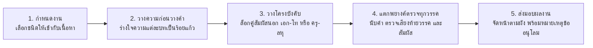

# 🪶 Thai Poetry Roikrong (`thai-poetry-roikrong`)

> **Agent Skill สำหรับแต่ง ตรวจ และแก้ไขบทร้อยกรองไทยตามฉันทลักษณ์อย่างแม่นยำ**  
> ครอบคลุม **โคลง ร่าย กลอน กาพย์ ฉันท์** ครบทุกชนิด (กว่า 50 รูปแบบ) พร้อมผังฉันทลักษณ์แบบข้อความ (Text-based Meter Diagrams) และระบบตรวจสอบพยางค์–สัมผัส–เอกโท–ครุลหุทีละวรรค  
> ✨ **ออกแบบและปรับจูนให้ทำงานได้โดดเด่นเป็นพิเศษกับโมเดลตระกูล Gemini** (Google Antigravity, Gemini CLI, Gemini Gems) และสามารถใช้งานร่วมกับ **Claude** (Claude Code, Claude Projects) รวมถึง AI Agent อื่นๆ ที่รองรับมาตรฐาน `SKILL.md` ได้อย่างสมบูรณ์

[](LICENSE)
[](SKILL.md)
[](SKILL.md)
[](SKILL.md)

---

## 📖 สารบัญ (Table of Contents)

- [✨ จุดเด่นของสกิลนี้ (Why This Skill?)](#-จุดเด่นของสกิลนี้-why-this-skill)
- [🤖 ความเข้ากันได้กับโมเดลและ Agent (Model & Agent Compatibility)](#-ความเข้ากันได้กับโมเดลและ-agent-model--agent-compatibility)
- [📚 ชนิดคำประพันธ์ที่รองรับ (Supported Poetic Forms)](#-ชนิดคำประพันธ์ที่รองรับ-supported-poetic-forms)
- [🧭 ตารางเลือกชนิดคำประพันธ์ให้เข้ากับเนื้อหา](#-ตารางเลือกชนิดคำประพันธ์ให้เข้ากับเนื้อหา)
- [🔍 กระบวนการทำงานและระบบสัญลักษณ์ (How It Works)](#-กระบวนการทำงานและระบบสัญลักษณ์-how-it-works)
- [📐 ตัวอย่างกฎฉันทลักษณ์สำคัญในสกิล](#-ตัวอย่างกฎฉันทลักษณ์สำคัญในสกิล)
- [🚀 วิธีติดตั้ง (Installation)](#-วิธีติดตั้ง-installation)
- [💡 ตัวอย่างคำสั่งใช้งาน (Example Prompts)](#-ตัวอย่างคำสั่งใช้งาน-example-prompts)
- [🎯 ตัวอย่างผลลัพธ์จากสกิล (Sample Outputs)](#-ตัวอย่างผลลัพธ์จากสกิล-sample-outputs)
- [🛠️ การชำระผังฉันทลักษณ์จากต้นฉบับ](#-การชำระผังฉันทลักษณ์จากต้นฉบับ)
- [📂 โครงสร้างไฟล์ (Repository Structure)](#-โครงสร้างไฟล์-repository-structure)
- [📚 แหล่งอ้างอิงวิชาการ (References)](#-แหล่งอ้างอิงวิชาการ-references)

---

## ✨ จุดเด่นของสกิลนี้ (Why This Skill?)

โดยทั่วไป AI มักแต่งคำประพันธ์ไทยผิดฉันทลักษณ์ เช่น นับพยางค์คลาดเคลื่อน ส่ง-รับสัมผัสผิดตำแหน่ง สับสนรูปวรรณยุกต์เอก-โทกับเสียงวรรณยุกต์ หรือวางครุ-ลหุในฉันท์ไม่ตรงผัง

สกิล **`thai-poetry-roikrong`** แก้ปัญหานี้ด้วยการวางโครงสร้างความรู้และกระบวนการคิดอย่างเป็นระบบ:

1. **ผังฉันทลักษณ์แบบข้อความล้วน (100% Text-Decoded Diagrams)** — ถอดผังฉันทลักษณ์ที่เดิมเป็นรูปภาพจากคลังข้อมูลวิชาการให้เป็นสัญลักษณ์ข้อความที่ AI อ่านและเทียบตำแหน่งได้ทันทีโดยไม่ต้องเดาจากความจำ
2. **กระบวนการแต่ง 5 ขั้นตอน (Structured Composition Workflow)** — บังคับให้ AI *วางความก่อนวางคำ → วางโครงสัมผัสนอกและตำแหน่งบังคับ (เอกโท/ครุลหุ) → เติมคำและสัมผัสใน → แตกพยางค์นับจริงทีละวรรคก่อนส่ง*
3. **ครอบคลุมคำประพันธ์ไทยครบทั้ง 5 ประเภทใหญ่ (50+ ชนิดย่อย)** — ตั้งแต่กลอนแปด โคลงสี่สุภาพ กาพย์ยานี ไปจนถึงโคลงดั้น โคลงโบราณ กาพย์ห่อโคลง ลิลิต และฉันท์ครบทั้ง 24 ชนิด
4. **ตรวจและแก้ไขบทร้อยกรองได้ (Poetry Linter & Editor)** — วิเคราะห์บทร้อยกรองที่ผู้ใช้ส่งมาเป็นรายบาท/รายวรรค ชี้จุดที่ผิดฉันทลักษณ์หรือเสียงท้ายวรรค พร้อมเสนอคำแก้ที่ถูกต้องตามกฎ
5. **ชำระผังเทียบกับตัวอย่างมาตรฐานแล้ว** — แก้ไขจุดที่รูปผังต้นฉบับในเว็บวาดคลาดเคลื่อนจากตัวอย่างจริงให้ตรงตามคณะฉันท์และหลักภาษาไทย

---

## 🤖 ความเข้ากันได้กับโมเดลและ Agent (Model & Agent Compatibility)

| แพลตฟอร์ม / โมเดล | ระดับความเหมาะสม | จุดเด่นเมื่อใช้งานร่วมกับสกิลนี้ |
| :--- | :---: | :--- |
| **Google Gemini**<br>*(Google Antigravity, Gemini CLI, Gemini Gems, AI Studio)* | ⭐ **แนะนำเป็นพิเศษ (Best Fit)** | โมเดลตระกูล Gemini มีคลังคำศัพท์ภาษาไทยที่กว้างขวาง เข้าใจการแบ่งพยางค์ เสียงวรรณยุกต์ไทย คำเป็น-คำตาย และคำบาลีสันสกฤต (ครุ-ลหุ) ได้แม่นยำ เมื่อเสริมด้วยผังและขั้นตอนตรวจในสกิลนี้จะได้บทร้อยกรองที่ทั้งถูกฉันทลักษณ์และสละสลวย |
| **Anthropic Claude**<br>*(Claude Code, Claude Desktop, Claude Projects)* | ✅ **รองรับเต็มรูปแบบ** | Claude มีความสามารถในการทำตามกฎ (Instruction Following) และการไล่ตรวจทีละขั้นตอน (Step-by-step Verification) ที่รัดกุมมาก ใช้แต่งและตรวจแก้ฉันทลักษณ์ตามผังได้ดีเยี่ยม |
| **Agent อื่นๆ ที่รองรับ `SKILL.md`**<br>*(Cursor, Windsurf, OpenAI Codex, GitHub Copilot)* | ✅ **รองรับเต็มรูปแบบ** | ใช้ไฟล์ `SKILL.md` มาตรฐานเดียวกัน สามารถติดตั้งผ่าน `npx skills` หรือวางในโฟลเดอร์สกิลของแต่ละ Agent ได้ทันที |

---

## 📚 ชนิดคำประพันธ์ที่รองรับ (Supported Poetic Forms)

| ประเภท | ชนิดย่อยที่รองรับในสกิล | ลักษณะบังคับหลัก |
| :--- | :--- | :--- |
| **๑. โคลง** | **โคลงสุภาพ:** โคลง ๒, โคลง ๓, โคลง ๔ สุภาพ, โคลง ๔ ตรีพิธพรรณ, โคลง ๔ จัตวาทัณฑี, โคลง ๕ (มณฑกคติ), โคลงกระทู้ (เดี่ยว/สอง/สาม/สี่)<br>**โคลงดั้น:** โคลง ๒ ดั้น, โคลง ๓ ดั้น, โคลง ๔ ดั้น (วิวิธมาลี, บาทกุญชร, ตรีพิธพรรณ, จัตวาทัณฑี)<br>**โคลงโบราณ:** วิชชุมาลี, จิตรลดา, สินธุมาลี, นันททายี (และชนิด "มหา" ทั้ง 4) | คณะ, พยางค์, สัมผัส, **รูปเอก–โท** (ใช้คำตายแทนเอกได้), คำเป็น–คำตาย, คำสร้อย |
| **๒. ร่าย และ ลิลิต** | ร่ายสุภาพ, ร่ายดั้น, ร่ายโบราณ, ร่ายยาว (เทศน์มหาชาติ/แหล่), ลิลิตสุภาพ, ลิลิตดั้น | วรรคละ 5 คำ ร้อยสัมผัสต่อเนื่อง จบด้วยโคลง ๒ สุภาพ หรือโคลงดั้น |
| **๓. กลอน** | **กลอนสุภาพ:** กลอน ๖, กลอน ๗, กลอน ๘, กลอน ๙<br>**กลอนลำนำ:** กลอนบทละคร, กลอนสักวา, กลอนเสภา, กลอนดอกสร้อย, กลอนขับร้อง<br>**กลอนตลาด:** กลอนเพลงยาว, กลอนนิราศ, กลอนนิยาย, กลอนเพลงปฏิพากย์ (เพลงฉ่อย, เพลงเรือ, ลำตัด ฯลฯ) | คณะ, สัมผัสนอก–สัมผัสใน, **เสียงวรรณยุกต์ท้ายวรรค** (สดับ–รับ–รอง–ส่ง), ข้อห้ามชิงสัมผัส/ยัติภังค์ |
| **๔. กาพย์** | กาพย์ยานี ๑๑ (ทั้งแบบปกติและแบบเพิ่มสัมผัสวรรค 3–4), กาพย์ฉบัง ๑๖, กาพย์สุรางคนางค์ ๒๘ (3 ลีลา), กาพย์สุรางคนางค์ ๓๒, กาพย์ห่อโคลง (3 แบบ / กาพย์เห่เรือ), กาพย์ขับไม้ห่อโคลง | คณะ, จำนวนคำต่อวรรค, สัมผัสระหว่างวรรคและระหว่างบท |
| **๕. ฉันท์ (24 ชนิด)** | **ฉันท์ ๘:** จิตรปทา, วิชชุมาลา, มาณวก, ปมาณิก<br>**ฉันท์ ๑๑–๑๔:** อุปัฏฐิตา ๑๑, อินทรวิเชียร ๑๑, อุเปนทรวิเชียร ๑๑, สาลินี ๑๑, อุปชาติ ๑๑, อาขยานิกา ๑๑, วังสัฏฐ ๑๒, อินทวงส ๑๒, โตฎก ๑๒, ภุชงคประยาต ๑๒, กมล ๑๒, วสันตดิลก ๑๔<br>**ฉันท์ ๑๕–๒๑:** มาลินี ๑๕, ประภัททก ๑๕, วาณินี ๑๖, กุสุมิตลดาเวลลิตา ๑๘, เมฆวิปผุชชิตา ๑๙, สัททุลวิกกีฬิต ๑๙, อีทิส ๒๐, สัทธราฉันท์ ๒๑ | คณะ, **ครุ (`ค`) – ลหุ (`ล`) ตรงทุกพยางค์**, ห้ามคำเกิน/ขาด, สัมผัสนอก |

---

## 🧭 ตารางเลือกชนิดคำประพันธ์ให้เข้ากับเนื้อหา

หากผู้ใช้ไม่ได้ระบุชนิดคำประพันธ์ สกิลจะช่วยเลือกชนิดที่เหมาะสมกับเนื้อหาและอารมณ์โดยอัตโนมัติ:

| เนื้อหา / อารมณ์ | ชนิดคำประพันธ์ที่แนะนำ |
| :--- | :--- |
| เรื่องทั่วไป / บทกลอนมาตรฐาน | **กลอน ๘ (กลอนสุภาพ)** |
| ข้อคิด คติเตือนใจ บทพูดขรึมขลัง | **โคลง ๔ สุภาพ** |
| พรรณนาธรรมชาติ ความงาม จังหวะเนิบช้า | **กาพย์ยานี ๑๑** |
| บรรยายดำเนินเรื่องต่อเนื่อง | **กาพย์ฉบัง ๑๖**, **กาพย์สุรางคนางค์** |
| โกรธ ต่อสู้ อารมณ์รุนแรง จังหวะเร่งเร้า | **กาพย์สุรางคนางค์ ๒๘** |
| บทไหว้ครู ยอพระเกียรติ | **สัททุลวิกกีฬิตฉันท์ ๑๙**, **สัทธราฉันท์ ๒๑** |
| บทชมความงาม บทคร่ำครวญ อาลัย | **อินทรวิเชียรฉันท์ ๑๑**, **วสันตดิลกฉันท์ ๑๔** |
| สำแดงฤทธิ์ ความอัศจรรย์ | **โตฎกฉันท์ ๑๒** |
| พรรณนาโวหาร ความตื่นเต้น คึกคัก | **ภุชงคประยาตฉันท์ ๑๒** |
| เล่าเหตุการณ์สลับบทพูด/ข้อคิด | **ลิลิต** (ร่ายเดินเรื่อง สลับกับโคลง) |
| บทขับร้อง บทละคร ขับเสภา | **กลอนสักวา**, **กลอนดอกสร้อย**, **กลอนบทละคร**, **กลอนเสภา** |
| บทเทศน์ บทสวด | **ร่ายยาว** |

---

## 🔍 กระบวนการทำงานและระบบสัญลักษณ์ (How It Works)

เมื่อผู้ใช้สั่งให้แต่งหรือตรวจร้อยกรอง สกิลจะกำหนดให้ AI ทำงานตามลำดับดังนี้:



### สัญลักษณ์ผังฉันทลักษณ์ใน `SKILL.md`
เพื่อให้โมเดลเข้าใจตำแหน่งคำและสัมผัสได้อย่างแม่นยำ สกิลนี้ใช้ระบบสัญลักษณ์ข้อความมาตรฐานเดียวตลอดทั้งไฟล์:
- `○` = คำ 1 พยางค์ (ไม่บังคับรูปวรรณยุกต์)
- `เอก` / `โท` = ตำแหน่งบังคับรูปวรรณยุกต์เอก (หรือคำตายแทนเอก) และรูปวรรณยุกต์โท
- `ค` / `ล` = พยางค์เสียงหนัก (**ครุ**) และพยางค์เสียงเบา (**ลหุ**) สำหรับฉันท์
- `[A]` `[B]` `[C]` = ตำแหน่งคำที่ต้องคล้องจองกัน (สัมผัสนอก)
- `(○ ○)` = คำสร้อยท้ายบาท/ท้ายบท
- `|` = เส้นแบ่งวรรค (1 บรรทัด = 1 บาท)

---

## 📐 ตัวอย่างกฎฉันทลักษณ์สำคัญในสกิล

### 1. ผังโคลง ๔ สุภาพ (30 คำ — เอก 7 โท 4)
```text
บาท 1  ○ ○ ○ เอก โท | ○ ○[A] (○ ○)
บาท 2  ○ เอก ○ ○ ○[A] | เอก โท[B]
บาท 3  ○ ○ เอก ○ ○[A] | ○ เอก (○ ○)
บาท 4  ○ เอก ○ ○ โท[B] | เอก โท ○ ○ (○ ○)
```

### 2. เสียงวรรณยุกต์คำสุดท้ายของกลอนสุภาพ (สดับ–รับ–รอง–ส่ง)
| วรรค | เสียงที่นิยม | ข้อห้าม |
| :--- | :--- | :--- |
| **วรรค 1 (สดับ)** | คำเต้น (เสียงที่ไม่ใช่สามัญ) | ไม่มี (ใช้เสียงสามัญก็ได้) |
| **วรรค 2 (รับ)** | **เสียงจัตวา** | ห้ามเสียงโท สามัญ ตรี และคำที่มีรูปเอก (เสียงเอกไม่มีรูปใช้ได้ แต่ท้ายวรรค 3 ต้องเป็นเสียงตรี) |
| **วรรค 3 (รอง)** | **เสียงสามัญ** | ห้ามเสียงจัตวา และห้ามคำที่มีรูปวรรณยุกต์ |
| **วรรค 4 (ส่ง)** | **เสียงสามัญ** | ห้ามคำตาย และห้ามคำที่มีรูปวรรณยุกต์ (อนุโลมคำตายเสียงตรีได้บ้าง) |

### 3. กฎการตรวจ 6 ขั้นตอนก่อนส่งงาน (Pre-Delivery Verification)
1. **แตกพยางค์ด้วยขีด (`-`):** เช่น `เพียร-เรียน-เพียร-อ่าน-รู้ | วิ-ชา` ระวังคำหลายพยางค์และอักษรนำ (`สวรรค์` = สะ-หวัน, `ธรรมชาติ` = ทำ-มะ-ชาด)
2. **ตรวจตำแหน่งบังคับ:** ชี้คำเอก-คำโททีละตำแหน่ง (ไม้ไต่คู้ ไม้ตรี ไม้จัตวา ไม่นับเป็นเอกโท) หรือระบุ `ค`/`ล` ทุกพยางค์ในฉันท์
3. **ตรวจสัมผัสนอก:** ต้องสระเดียวกัน มาตราตัวสะกดเดียวกัน พยัญชนะต้นต่างเสียงกัน และตกตรงตำแหน่งรับ
4. **ตรวจเสียงท้ายวรรคกลอน:** เช็กเสียงท้ายวรรคทั้ง 4 และห้ามฉีกคำข้ามวรรค (ยัติภังค์)
5. **ตรวจสัมผัสในและข้อห้ามชิงสัมผัส:** ไม่ให้เสียงคำส่งไปตกทั้งสองตำแหน่งรับในวรรคเดียวกัน
6. **ตรวจความหมาย:** อ่านรวดเดียวต้องได้ใจความสละสลวย ไม่ยัดคำเพื่อเอาสัมผัส

---

## 🚀 วิธีติดตั้ง (Installation)

สกิลนี้ออกแบบตามมาตรฐาน `SKILL.md` จึงติดตั้งได้ทั้งบน **Gemini (Antigravity / Gemini CLI)**, **Claude Code**, และ Agent อื่นๆ:

### 1. ติดตั้งบน Google Antigravity / Gemini CLI (แนะนำ ⭐)
คัดลอกโฟลเดอร์ไปไว้ที่ Global Skills หรือ Workspace Skills:
```bash
# ติดตั้งแบบใช้ได้ทุกโปรเจกต์บน Google Antigravity (Global)
git clone https://github.com/um1981/thai-poetry-roikrong.git ~/.gemini/antigravity/skills/thai-poetry-roikrong

# หรือติดตั้งสำหรับ Gemini CLI
git clone https://github.com/um1981/thai-poetry-roikrong.git ~/.gemini/skills/thai-poetry-roikrong

# หรือติดตั้งเฉพาะในโปรเจกต์ (Workspace)
git clone https://github.com/um1981/thai-poetry-roikrong.git .agent/skills/thai-poetry-roikrong
```

### 2. ติดตั้งผ่าน Skills CLI (รองรับทั้ง Gemini, Claude, Cursor, Codex)
```bash
npx skills add um1981/thai-poetry-roikrong
```

### 3. ติดตั้งบน Claude Code / Cursor / Windsurf / Agent อื่นๆ
```bash
# สำหรับ Claude Code (Global)
git clone https://github.com/um1981/thai-poetry-roikrong.git ~/.claude/skills/thai-poetry-roikrong

# หรือวางในโฟลเดอร์สกิลกลางของโปรเจกต์
git clone https://github.com/um1981/thai-poetry-roikrong.git .agents/skills/thai-poetry-roikrong
```

### 4. ใช้งานใน Gemini Gems / Claude Projects / Web Chat
หากใช้งานผ่านหน้าเว็บ (เช่น **Gemini Gems**, **Google AI Studio**, หรือ **Claude Projects**) สามารถนำเนื้อหาในไฟล์ [`SKILL.md`](SKILL.md) ไปวางในช่อง **System Instructions** หรืออัปโหลดเป็นไฟล์ **Knowledge** ได้ทันที

---

## 💡 ตัวอย่างคำสั่งใช้งาน (Example Prompts)

เมื่อติดตั้งสกิลแล้ว สามารถสั่งงานเป็นภาษาไทยได้ทันที ระบบจะเรียกใช้สกิลอัตโนมัติเมื่อพบคำสำคัญเกี่ยวกับการแต่งกลอน โคลง กาพย์ ฉันท์ หรือการตรวจฉันทลักษณ์:

### ✍️ สั่งแต่งบทร้อยกรองใหม่
- *"แต่ง **โคลงสี่สุภาพ** ๒ บท เรื่องคุณค่าของการอ่านหนังสือ พร้อมร้อยสัมผัสระหว่างบท"*
- *"แต่ง **กลอนแปด** ๓ บท ชมความงามของสายฝนยามเย็น ขอสัมผัสในสละสลวยและเสียงวรรณยุกต์ท้ายวรรคถูกต้องตามหลักนิยม"*
- *"แต่ง **อินทรวิเชียรฉันท์ ๑๑** จำนวน ๒ บท สำหรับใช้ในพิธีไหว้ครู พร้อมแตกพยางค์ชี้ตำแหน่งครุ-ลหุให้ดูด้วย"*
- *"แต่ง **กลอนสักวา** ๑ บท (๘ วรรค) เรื่องบรรยากาศตลาดน้ำยามเช้า"*
- *"แต่ง **โคลงกระทู้เดี่ยว** โดยใช้คำกระทู้ว่า `รัก-เรียน-เพียร-รู้`"*
- *"อยากได้บทร้อยกรองบรรยายฉากต่อสู้ดุเดือด ช่วยเลือกชนิดคำประพันธ์ที่เหมาะกับอารมณ์แล้วแต่งให้ ๒ บท"*

### 🔎 สั่งตรวจและแก้ไขบทร้อยกรองที่มีอยู่
- *"ช่วยตรวจโคลงสี่สุภาพบทนี้ให้หน่อยว่าถูกฉันทลักษณ์ไหม ตำแหน่งเอกโทและสัมผัสครบหรือเปล่า ถ้าผิดช่วยเกลาให้ด้วย:"*
- *"ตรวจกลอนแปดบทนี้ทีละวรรค นับพยางค์ ตรวจเสียงท้ายวรรค (สดับ-รับ-รอง-ส่ง) และเช็กว่ามีสัมผัสซ้ำหรือชิงสัมผัสไหม"*

---

## 🎯 ตัวอย่างผลลัพธ์จากสกิล (Sample Outputs)

### โคลง ๔ สุภาพ
*(เอก 7: อ่าน ใคร่ ก่อ ย่อม ยิ่ง หมั่น แก่ / โท 4: รู้ เกื้อ เอื้อ ผู้ / สัมผัส: ชา–ญา–พา และ เกื้อ–เอื้อ)*
```text
เพียรเรียนเพียรอ่านรู้    วิชา
คิดใคร่ครวญปัญญา       ก่อเกื้อ
ความเพียรย่อมนำพา      สุขยิ่ง จริงแฮ
จงหมั่นฝึกตนเอื้อ        แก่ผู้อื่นเทอญ
```

### กลอน ๘ (กลอนสุภาพ)
*(สัมผัส: ย่ำ–พรำ, สณฑ์–ชล–คน / เสียงท้ายวรรค: โท – จัตวา – สามัญ – สามัญ)*
```text
เมฆลอยคล้อยปลายฟ้าคราเย็นย่ำ    สายฝนพรำฉ่ำชื่นรื่นไพรสณฑ์
หยาดน้ำใสไหลรินดินชุ่มชล        ปลอบใจคนพ้นร้อนผ่อนทุกข์ภัย
```

### กาพย์ยานี ๑๑ (แบบที่ 2)
*(สัมผัส: ใส–ไป, หา–ลา–วา)*
```text
ยามเช้าฟ้าสดใส      นกโผไปสู่เวหา
ลมโชยกลิ่นมาลา     ให้ชีวาเบิกบานใจ
```

### อินทรวิเชียรฉันท์ ๑๑
*(ครุ-ลหุ: `ค ค ล ค ค | ล ล ค ล ค ค` / ลหุ: ตะ, ระ, อุ และ กระ, ก็, ระ, ระ)*
```text
ยามเย็นตะวันรอน       ระอุผ่อนและแสงทอง
คลื่นน้ำกระเพื่อมฟอง   ก็ระยิบระยับตา
```

### ร่ายสุภาพ (จบด้วยโคลง ๒ สุภาพ)
*(เอก: แน่ ร่วม ต่อ / โท: แท้ แพ้ สู้)*
```text
งานใหญ่ใช่งานเดียว ต้องเกี่ยวแรงหลายคน ต่างตนต่างช่วยกัน ร่วมฝันร่วมแรงใจ
งานใดย่อมเสร็จสม อุดมผลแน่แท้ จงร่วมจิตอย่าแพ้ ต่อสู้ด้วยกัน เทอญนา
```

---

## 🛠️ การชำระผังฉันทลักษณ์จากต้นฉบับ

ผังรูปภาพบางรายการในเว็บไซต์ต้นฉบับวาดไม่ตรงกับบทตัวอย่างและคณะฉันท์ในหน้าเดียวกัน สกิลนี้ได้ตรวจสอบและยึดตามแบบที่บทตัวอย่างและคณะฉันท์ตรงกัน ดังนี้:
- **กาพย์ฉบัง ๑๖:** รูปผังโยงท้ายวรรค 2 กับวรรค 3 แต่ตัวอย่างและผังสัมผัสในหน้าฉันทลักษณ์ใช้ท้ายวรรค 1 สัมผัสกับท้ายวรรค 2
- **จิตรปทาฉันท์ ๘:** รูปผังวางเส้นโยงท้ายบาทไว้ที่บาท 1 กับ 2 แต่ตัวอย่างและฉันท์ ๘ ชนิดอื่นใช้ท้ายบาท 2 สัมผัสกับท้ายบาท 3
- **อุปัฏฐิตาฉันท์ ๑๑:** รูปผังวาดวรรคหลังเป็น `ล ล ค ค ล ค` และโยงสัมผัสไปคำที่ 4 แต่ตัวอย่างจริงเป็น `ล ล ค ล ค ค` รับสัมผัสที่คำที่ 3
- **เมฆวิปผุชชิตาฉันท์ ๑๙:** รูปผังวาดวรรคแรกขาดไป 1 พยางค์ (11 วง) แก้ให้ครบ 12 พยางค์ตามตัวอย่างจริง (`ล ค ค ค ค ค ล ล ล ล ล ค`)
- **สัททุลวิกกีฬิตฉันท์ ๑๙:** รูปผังวาดครุลหุคลาดเคลื่อนและวรรค 2 มี 4 วง แก้เป็น 12+5+2 ตรงตามคณะ `ม ส ช ส ต ต ค`
- **ร่ายดั้น:** รูปผังจัดส่วนจบเป็นกลุ่ม 5-5-4-(2) ซึ่งเมื่อเรียงคำแล้วตรงกับบาท 3 และบาท 4 ของโคลงดั้นวิวิธมาลี

---

## 📂 โครงสร้างไฟล์ (Repository Structure)

```text
thai-poetry-roikrong/
├── SKILL.md      # ไฟล์คำสั่งและผังฉันทลักษณ์ฉบับเต็มสำหรับ AI Agent
├── README.md     # เอกสารแนะนำสกิล วิธีติดตั้ง และตัวอย่างการใช้งาน
└── LICENSE       # สัญญาอนุญาตใช้งาน (MIT License)
```

---

## 📚 แหล่งอ้างอิงวิชาการ (References)

องค์ความรู้และผังฉันทลักษณ์ในสกิลนี้รวบรวมและถอดความจากแหล่งอ้างอิงมาตรฐานด้านฉันทลักษณ์ไทย:
1. **โครงการเครือข่ายศิลปวัฒนธรรม มหาวิทยาลัยธรรมศาสตร์ (ThaiARC)** — [ร้อยกรองไทย (https://thaiarc.tu.ac.th/poetry/)](https://thaiarc.tu.ac.th/poetry/)
2. **หลักภาษาไทย** — กำชัย ทองหล่อ
3. **Thai Meter** — Thomas John Hudak (1990)

---

## 📄 สัญญาอนุญาต (License)

เผยแพร่ภายใต้สัญญาอนุญาต [MIT License](LICENSE) สามารถนำไปใช้งาน ดัดแปลง และเผยแพร่ต่อได้อย่างเสรี
